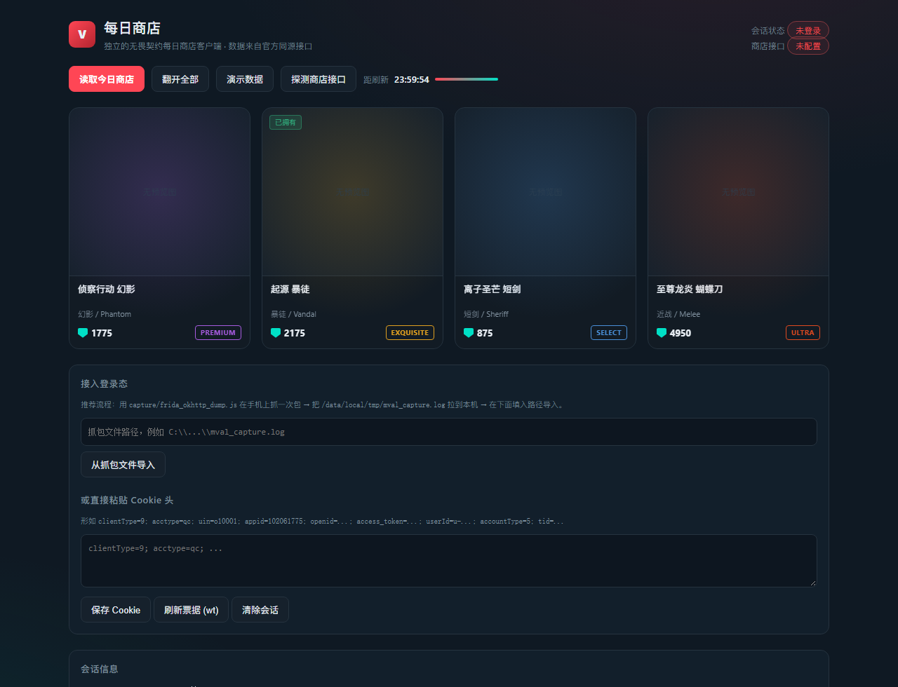

# 无畏契约 · 每日商店（独立实现）

一个不依赖掌瓦 App 的「每日商店」客户端：用掌瓦自己那套接口和登录态，读你自己账号的今日商店。

```
val-shop/
├─ analysis/掌瓦数据链路分析.md   ← 逆向报告：域名、鉴权、Cookie、票据、game_zone 全在这里
├─ capture/
│   ├─ frida_okhttp_dump.js       ← 首选抓包方案（Hook OkHttp，连 Cookie/body 一起 dump）
│   └─ mitm_zhangwa.py            ← 备选（mitmproxy 插件）
├─ server/
│   ├─ zhangwa.py                 ← 协议层复刻（可直接当库用）
│   ├─ app.py                     ← FastAPI 后端
│   └─ requirements.txt
├─ web/index.html                 ← 单文件前端（翻牌动画 + 品质角标 + 刷新倒计时）
├─ smoke_test.py                  ← 离线冒烟测试（不联网）
└─ docs/shop-ui.png               ← 界面截图
```



---

## 快速开始

```powershell
cd val-shop
python -m venv .venv
.\.venv\Scripts\python.exe -m pip install -r server\requirements.txt

# 自检（不联网）
.\.venv\Scripts\python.exe smoke_test.py

# 起服务
.\.venv\Scripts\python.exe -m uvicorn server.app:app --port 8787
# 打开 http://127.0.0.1:8787  →  点「演示数据」先看效果
```

---

## 一、商店接口怎么来的（必读）

**结论先说**：掌瓦 APK 里**没有**商店页面的接口路径。

商店页面是**服务端下发的 React Native bundle / 动态 UI（`com.aladdinx.plaster`）**渲染的，
native 端只提供品质图标（`res/drawable-xhdpi-v4/ic_val_goods_quality_1..5.png`）和分享图。
能证明商店存在的是这几个开关（`res/layout/activity_feature_switches.xml`）：

```
商店每日首次查看是否使用翻牌动画
翻牌前的卡背隐藏皮肤的品质
```

对应 `com.tencent.switches.protocol.UserSwitch` 的
`val_close_shop_commodity_animation` / `val_hide_shop_commodity_quality`，
切换时只往 RN 层发 `receiveBrandSignal`。

所以：**抓一次包**就能拿到路径。抓包工具已经写好了。

### 抓包（Frida，推荐）

```powershell
# 手机已 root / 有 frida-server
frida -U -f com.tencent.apps.valorant -l capture\frida_okhttp_dump.js --no-pause

# 在 App 里点开「每日商店」，然后:
adb pull /data/local/tmp/mval_capture.log .
```

脚本会连**请求头 / Cookie / JSON body / 响应体**一起打出来
（`okhttp3.Request$Builder#build` + `BridgeInterceptor#intercept`，
顺带把 `CookieHelper` 拼出来的 Cookie 和 `AppContext` 的票据字段单独打一份）。

日志里找 `POST https://app.mval.qq.com/go/...` 里带 `store`/`shop`/`daily` 那条就是。

### 抓包（mitmproxy，备选）

```powershell
mitmdump -s capture\mitm_zhangwa.py --set outdir=. -p 8080
# 手机 WiFi 代理指向本机:8080，把 mitmproxy CA 装到系统证书
```

### 拿到路径之后

```powershell
# Windows
$env:ZW_SHOP_PATH="/go/agame/xxx/yyy"
$env:ZW_SHOP_BODY='{"roleId":"..."}'
# 或者直接在网页里用「接口 / 调试输出」面板填路径调一次
```

也可先点「探测商店接口」，脚本会拿 `server/zhangwa.py` 里的 `SHOP_CANDIDATES`
逐个试（POST/GET 都试），碰巧命中就不用抓包了。

---

## 二、登录态怎么来

三条路，从易到难：

| 方式 | 说明 |
|---|---|
| **导入抓包** | 后端会自动从 Frida 日志 / mitmproxy jsonl 里把 Cookie 抠出来（`POST /api/session/import-capture`）。**推荐** |
| **粘贴 Cookie** | 形如 `clientType=9; acctype=qc; uin=o10001; appid=102061775; openid=...; access_token=...; userId=u-...; accountType=5; tid=...` |
| **自己走 SSO** | 需要在你自己的 App 里集成 QQ 互联 / 微信开放平台 SDK 拿 `access_token`+`openid`，再走 `/go/auth/login_by_qq`。`server/zhangwa.py` 里 `/go/auth/*` 的方法都写好了 |

---

## 三、协议层复刻说明（`server/zhangwa.py`）

和 APK 里 1:1 对齐的四件事：

| # | 行为 | APK 里的位置 |
|---|---|---|
| 1 | 域名重写 `mlol.qt.qq.com → app.mval.qq.com` | `com/tencent/qt/qtl/activity/ValUrlTransformer` |
| 2 | 响应信封 `{"result":0,"msg":"","data":{}}`，`999999` = 票据异常 | `com/tencent/container/protocol/a/a.java` |
| 3 | val 域请求注入 `game_zone=val` / `source_game_zone` | `com/tencent/container/app/AppEnvironment`、`ValZoneBodyWrapper` |
| 4 | Cookie 固定拼装 | `com/tencent/container/c/a/a.java` (CookieHelper) |

硬编码常量（都来自 `AndroidManifest.xml`）：

```python
HOST_PROD = "app.mval.qq.com"
APPID_QQ  = "102061775"          # openqq_appid
APPID_WX  = "wxcbb49f1f39656c2a" # wx_appid
CLIENT_TYPE = "9"
ACCT_QQ, ACCT_WX = 5, 2
```

当作库用：

```python
import asyncio
from server.zhangwa import ZhangwaSession, ZhangwaClient

sess = ZhangwaSession.from_cookie_string(
    "clientType=9; acctype=qc; uin=o10001; appid=102061775; openid=...; "
    "access_token=...; userId=u-...; accountType=5; tid=...")

async def main():
    c = ZhangwaClient(sess)
    print(await c.get_roles_by_game("val"))          # 角色
    print(await c.gun_skin_detail("some-arm-id"))    # 武器皮肤详情
    c.SHOP_PATH = "/go/..."                          # 抓包填这里
    print(await c.fetch_store())
    await c.aclose()

asyncio.run(main())
```

---

## 四、REST 接口

| 方法 | 路径 | 说明 |
|---|---|---|
| GET | `/api/health` | 健康检查 + 商店路径是否已配置 |
| GET | `/api/session` | 当前会话信息 |
| POST | `/api/session/cookie` | `{"cookie": "..."}` |
| POST | `/api/session/import-capture` | `{"file": "mval_capture.log"}` |
| POST | `/api/session/logout` | 清会话 |
| POST | `/api/refresh` | 刷新 ct/wt 票据 |
| GET | `/api/roles?game_id=val` | 角色列表 |
| GET | `/api/gamelist` | 可绑定游戏列表 |
| GET | `/api/store` | 今日商店（归一化后） |
| POST | `/api/store/raw` | `{"path": "/go/...", "body": {...}}` 原样调 |
| POST | `/api/store/probe` | 候选路径探测 |
| GET | `/api/asset/gun-skin?arm_id=...` | 武器皮肤详情 |
| GET | `/api/asset/showcase` | 名片橱窗（已拥有皮肤渲染数据） |
| GET | `/api/card` | 个人名片（皮肤总数/总价值） |
| GET | `/api/capture/endpoints?file=...` | 列出抓包文件里的全部 `/go/` 接口 |

---

## 五、前端

`web/index.html`，单文件、零依赖、无 CDN。

- 4 张卡 → `rotateY(180deg)` 翻牌，按顺序自动翻开（复刻掌瓦的「每日首次查看翻牌动画」）
- 品质角标 5 档配色对应 `ic_val_goods_quality_1..5`：
  `SELECT 蓝 / DELUXE 绿 / PREMIUM 紫 / EXQUISITE 金 / ULTRA 红`
- 主色直接用了掌瓦动态 UI 里的 `#0f1923` / `#ff4655`
- 刷新倒计时进度条
- `?demo=1` 直接进演示态

---

## 六、国际服 / 其他路线

掌瓦这套是**国服**路线。如果你要同时支持国际服，走 Riot 官方契约更稳：

```
lockfile → /entitlements/v1/token → pd.<shard>.a.pvp.net/store/v3/storefront/<puuid>
皮肤元数据 → https://valorant-api.com/v1/weapons/skins
```

`server/app.py` 的 `normalize_store()` 已经对两边的字段名做了兼容
（`SkinsPanelLayout.SingleItemOffers`、`items`、`offers`、`list` 都会尝试），
接入时只要再加一个 provider 把数据塞进同一个契约即可。

---

## 七、排查

| 现象 | 原因 |
|---|---|
| `result=999999` | wt 票据过期。后端会自动刷新并重试一次；仍失败说明 `ct` 也过期了，重新抓包 |
| `HTTP 403 / 返回 HTML` | 域名不对，确认是 `app.mval.qq.com` 不是 `mlol.qt.qq.com` |
| 商店返回空 `items` | 字段名不一样，看 `/api/store/raw` 的原始 JSON，在 `normalize_store()` 里加映射 |
| Frida 抓不到 | App 用了多进程，加 `--enable-jit` 或用 `frida -U -n 掌上无畏契约` 再 spawn 子进程 |
| 证书固定拦不住 | 直接用 Frida 方案，不走代理 |

---

## 免责

本工具只用来读取**你自己账号**的商店数据，等价于官方 App 里那个页面。
请勿用于批量爬取或对服务器造成压力。
